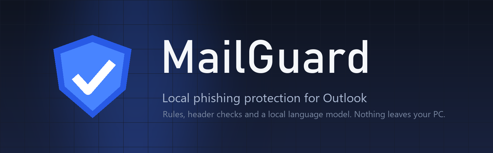
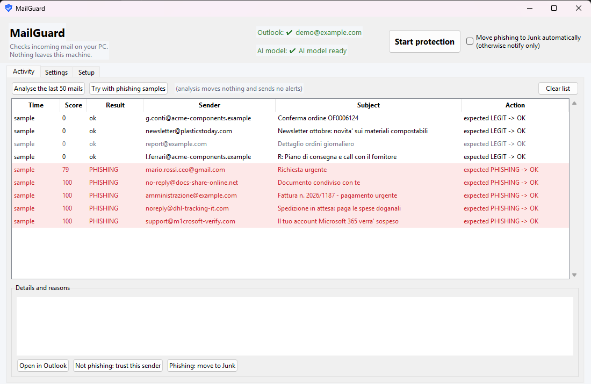
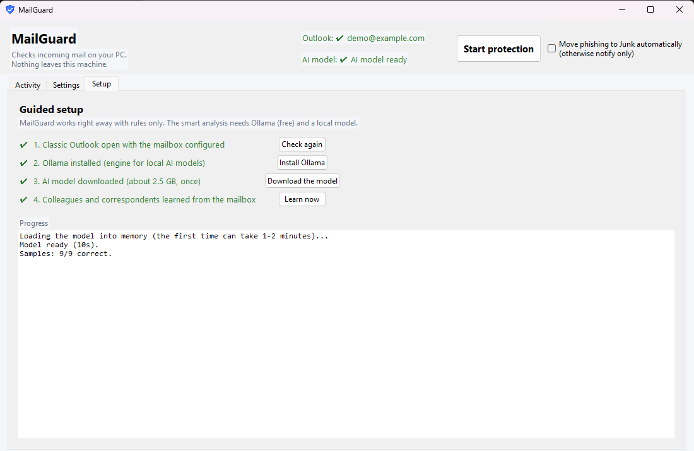

<p align="center">
  
</p>

<p align="center">
  <a href="https://github.com/SinghProbjot/mailguard/releases/latest"></a>
  <a href="https://github.com/SinghProbjot/mailguard/actions/workflows/build.yml"></a>
  <a href="LICENSE"></a>
  
</p>

MailGuard watches the Inbox of classic Outlook for Windows and flags phishing that got past the server side filters. It runs entirely on the PC: header checks, deterministic rules learned from real campaigns, and an optional local language model that reads the mail and explains its verdict. No mail, link or address ever leaves the machine.

It was written for a small Italian manufacturing company after several waves of credential phishing arrived from compromised Microsoft 365 tenants of real suppliers. Those mails pass SPF, DKIM and DMARC, so reputation based filters let them in. What gives them away is visible to a careful reader: an obfuscated sender address, a link that bounces through two Google redirects, a generic "your documents are available" from a company you have never dealt with. MailGuard looks for exactly those things.

## What it does

When a new message arrives, MailGuard extracts the real SMTP sender, the Reply-To, the authentication results, the subject, the text, every link with its true destination (Microsoft Safe Links and Google open redirects are unwrapped) and the attachment names. It then runs three layers:

1. **Trust first.** Colleagues, domains you regularly write to, replies to threads you started and authenticated mail from well known services are considered trusted. They skip the model and only a short list of hard rules still applies to them, so a compromised supplier account can still be caught.
2. **Deterministic rules.** Failed SPF, DKIM or DMARC. A sender domain that imitates yours or a known brand. A colleague's display name on an external address. An obfuscated or malformed sender address. Link text that shows one domain while pointing to another. URL shorteners, open redirect chains, links to raw IP addresses. Dangerous attachment types. A first time sender asking you to sign in, open a document or update payment details. A reply to one of your threads from a domain you never wrote to. Every rule carries points and a one line explanation.
3. **A local model, when needed.** For external mail that is not trusted and not already settled by the rules, a small language model running in Ollama reads the message and returns a probability and up to three reasons. The model alone can never push a mail over the "suspect" threshold; it needs at least one rule on its side. This keeps a 4B model from flagging every newsletter as a threat.

Points add up to a score from 0 to 100. Above 40 the mail is marked "to verify" with an Outlook category and a Windows notification. Above 70 it is treated as phishing and, if you enabled automatic actions, moved to Junk. Every decision, with its reasons, goes to a local log and to the activity view.

<p align="center">
  
</p>

## Installation

Download `MailGuard-Setup-<version>.exe` from the [latest release](https://github.com/SinghProbjot/mailguard/releases/latest) and run it. The installer is per user, needs no administrator rights, adds a Start Menu entry and offers to start MailGuard at logon, minimised to the tray. You can also take the portable `MailGuard.exe` from the same release and run it from any folder.

The executables are built by the GitHub Actions workflow in this repository from the tagged source. Until the binaries are signed, Windows SmartScreen will show a warning the first time; choose "More info" and "Run anyway", or verify the SHA256 against `SHA256SUMS.txt` in the release first.

Requirements:

- Windows 10 or 11.
- Classic Outlook for Windows, open and configured with the mailbox. The new Outlook does not expose the automation interface MailGuard relies on.
- Optionally, [Ollama](https://ollama.com) and a model. The guided setup inside the application installs Ollama through winget and downloads `qwen3:4b` (about 2.5 GB, once). Without it MailGuard still works with the rule layer only.

A GPU with 4 GB of memory or more makes the model answer in a few seconds per mail. On CPU it works but takes noticeably longer.

### First run

1. Start MailGuard. It connects to Outlook, picks the default mailbox and derives your company domain from your address.
2. Open the Installation tab and follow the four steps. The last one reads your Sent Items and Inbox to learn who your colleagues and habitual correspondents are. This takes a couple of minutes on a large mailbox and happens on the PC.
3. Open Settings, add any sister domains of your organisation, type the company name and sector (the model uses them to understand what normal mail looks like for you), enable autostart, save.
4. Press "Start protection". Closing the window leaves MailGuard running in the tray.

Leave "Move phishing to Junk automatically" off for the first few days. You will receive notifications only. If a legitimate mail is flagged, select it in the activity view and press "Not phishing: trust this sender": the sender becomes trusted and the mail is put back. When you are happy with the results, enable automatic actions.

The interface, the notifications and the explanations are available in English and Italian. The installer asks which one you want, and the choice can be changed later in Settings. Contributions for other languages only need a new column in `mailguard/i18n.py`.

<p align="center">
  
</p>

## Privacy

MailGuard has no network code of its own except for two HTTP calls to `localhost:11434`, where Ollama runs. The guided setup downloads Ollama and the model from their official servers and that is the only time anything is fetched from the Internet. Mail content is never uploaded, logged outside your profile or used to train anything. Everything MailGuard keeps is in `%APPDATA%\MailGuard`:

| File | Content |
|---|---|
| `config.json` | Your settings, trusted and blocked lists |
| `contacts.json` | Names and addresses of internal colleagues |
| `known_domains.json` | Domains you exchange mail with |
| `sent_index.json` | Message IDs of your sent mail, used to recognise replies to your own threads |
| `mailguard_log.jsonl` | One line per analysed mail with score, level and reasons |
| `feedback.jsonl` | Your "is phishing" and "is not phishing" verdicts |

The uninstaller asks whether to remove this folder.

## Running from source

```powershell
git clone https://github.com/SinghProbjot/mailguard.git
cd mailguard
pip install -r requirements.txt

python -m mailguard                  # desktop application
python -m mailguard --tray           # start minimised, protection on
python -m mailguard test             # run the built in samples through the pipeline
python -m mailguard scan --last 50   # analyse the last 50 mails, report only, no notifications
python -m mailguard watch            # command line watcher, alerts only
python -m mailguard watch --apply    # command line watcher, moves phishing to Junk
python -m mailguard learn            # rebuild contacts and known domains
```

Add `--no-model` to any command to use the rule layer only. `--folder "Posta eliminata"` (or whatever your Deleted Items folder is called) lets you run `scan` against another folder, which is a convenient way to test the tool on phishing you already caught.

To build the executable and the installer you need [PyInstaller](https://pyinstaller.org) (in the requirements) and [Inno Setup 6](https://jrsoftware.org/isinfo.php):

```powershell
.\build_exe.ps1      # dist\MailGuard.exe
.\build_setup.ps1    # dist\MailGuard-Setup-<version>.exe
```

## How the pieces fit

```
mailguard/
  outlook_client.py   COM access to Outlook: folders, items, headers, moves, categories
  extract.py          Turns an Outlook item into a Mail object: sender, auth results, links, attachments
  rules.py            Deterministic findings with points and explanations
  scorer.py           Trust logic and the combination of rules and model into a score
  model_llm.py        Ollama client, prompt and JSON schema for the local model
  model.py            Optional Laya backend (needs fine tuning to be useful, see below)
  learn.py            Builds contacts, known domains and the sent mail index from the mailbox
  engine.py           Orchestrates everything; used by both the GUI and the command line
  gui.py              tkinter application and tray icon
  paths.py            Where data lives (%APPDATA%\MailGuard) and config loading
  i18n.py             Every user facing string, in English and Italian
  samples.py          Synthetic phishing and legitimate mails for the test command
```

The engine runs in one worker thread that owns the COM objects; the interface only sends it tasks and renders events. The watcher polls the Inbox every twenty seconds, which is cheap because Outlook returns items sorted by arrival and the loop stops at the first one it has already seen.

## Tuning

Everything lives in `config.json`, and the Settings tab covers the common cases.

- `thresholds.suspect` and `thresholds.phishing` (default 40 and 70). Lower them if phishing is scoring in the 30s on your mailbox, raise them if you see too many notifications.
- `trusted_domains`, `trusted_senders`, `blocked_domains`, `blocked_senders`. The feedback buttons maintain these for you; free mail providers go in the sender lists, not the domain lists.
- `safe_link_domains`. Services whose links should never count against a sender.
- `brands`. Display names that are commonly impersonated, with their real domains. A mail whose display name mentions a brand but comes from elsewhere earns points.
- `ollama_model`. Any instruct model Ollama can run and that supports structured output. `qwen3:8b` is noticeably better if you have 8 GB of GPU memory.

The point values are in `rules.py` and `scorer.py`, each next to the rule it belongs to.

## Limitations

- Classic Outlook on Windows only. There is no Graph API or IMAP backend at the moment.
- Two interface languages, English and Italian. The lure word list used by one of the rules covers the same two languages; mail in other languages still gets the header, link and model checks.
- A 4B model is a modest judge. It is good at spotting classic lures and bad at telling an unusual but legitimate business mail from a scam, which is why it never decides alone.
- No attachment inspection yet. PDFs carrying a QR code or a single link are a growing pattern and are on the list.

## About the Laya backend

The project started as an experiment with [Laya](https://huggingface.co/convaiinnovations/laya), an open decision model that answers typed yes/no, choice and score questions in one forward pass. Zero shot it turned out to be unusable for this task (it rated nearly every mail as phishing), but it is fast and cheap to fine tune, and `feedback.jsonl` accumulates exactly the labelled data such a fine tune needs. The backend is kept behind `"model": "laya"` in the configuration for that reason. Install it with `pip install laya` if you want to experiment; the executable does not include it.

## License

MIT. See [LICENSE](LICENSE).
